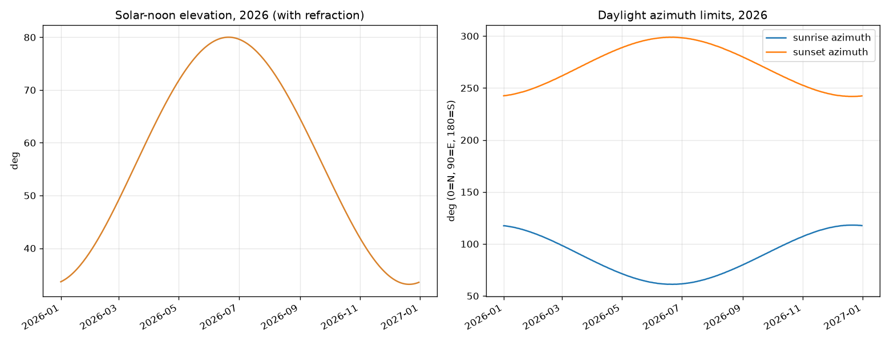

# SolarTracker

[](https://www.python.org/)
[](LICENSE)

SolarTracker computes the sun's azimuth and elevation at a configured observer site using NASA JPL's DE440s planetary ephemeris through [Skyfield](https://rhodesmill.org/skyfield/). It is the software foundation for a dual-axis solar tracker; the current release is a desktop console that reports sun position, sunrise, and sunset.

- [Overview](#overview)
- [Hardware and goal](#hardware-and-goal)
- [Annual sun range](#annual-sun-range)
- [Install](#install)
- [Usage](#usage)
- [Testing](#testing)
- [Project layout](#project-layout)
- [Roadmap](#roadmap)
- [License](#license)

## Overview

The console reads an observer site (latitude, longitude, and elevation), loads DE440s, and prints the sun's topocentric azimuth (eastward from true north) and elevation, including atmospheric refraction by default. Sunrise and sunset for the same civil date are included in the report.

Site coordinates that belong to a real installation live only in a gitignored `site_local.py`. The repository ships `site.example.py` with a public placeholder so the project can be cloned and run without exposing a private location.

## Hardware and goal

The long-term goal is a dual-axis tracker that points a payload at the sun. Position solutions in this repository are accurate enough for that job: Skyfield plus DE440s is compared in the test suite against the public NREL Solar Position Algorithm (SPA) reference case for the laboratory site in Golden, Colorado (Reda & Andreas, NREL/TP-560-34302).

On-controller firmware (planned around an ESP32) is deferred. This repository is the Python model, console, and tests that a later firmware port can follow.


## Annual sun range

The chart below is for the configured home site (north Texas), computed at 1-minute steps over 2026 with Skyfield and JPL DE440s. It does not publish the site's coordinates.



| Extreme | Value | When |
| --- | --- | --- |
| Highest elevation | ~80.0° | 21 Jun, 1:27 PM CDT |
| Lowest noon elevation | ~33° | late December |
| Summer sunrise azimuth | ~61° (northeast) | 22 Jun, ~6:18 AM CDT, with refraction |
| Summer sunset azimuth | ~299° (northwest) | 22 Jun, ~8:37 PM CDT |
| Required azimuth drive | ~61°–299° (238° sweep) | |
| Required elevation drive | 0–80° | |

Atmospheric refraction shifts these figures by less than half a degree (geometric: max elevation 80.011°, azimuth 61.558°–298.427°; with refraction: 80.014°, 61.143°–298.866°).

`python tools/annual_extremes.py --year 2026 --output docs/sun_year_2026.png` reproduces the computation for whatever site is configured (about 90 s). It prints angles and times only, never coordinates. The plot needs matplotlib, which is optional and is not in `requirements.txt`.

## Install

Python 3.10 or later is required. From the project root:

```bash
python3 -m venv .venv
source .venv/bin/activate
pip install -r requirements.txt
```

On first run, SolarTracker downloads JPL's `de440s.bsp` (about 31 MB, years 1849–2150) into the project root if the file is not already there, and Skyfield may also download small timescale files. Those files are gitignored. The ephemeris is fetched only when missing; it is never re-downloaded afterward. You can also copy a local `de440s.bsp` into the project root yourself. To store data somewhere else, set `SOLARTRACKER_DATA` to that directory.

DE440s is a fixed snapshot published by JPL in 2020 that never changes. Replace the file only when JPL publishes a newer or patch release (for example DE442, released in 2025 as a Uranus-focused update to DE440), not on a schedule.

Configure your site (optional, but recommended for personal use):

```bash
cp site.example.py site_local.py
```

Then edit `site_local.py` with your latitude, longitude, and elevation in meters. Do not commit that file.

## Usage

From the project root, with the virtual environment active, `python console.py` opens a live view that refreshes the sun's azimuth and elevation every second, along with the commanded tracker-frame pose and stow status. While that view is running:

- **T** — today's track table (15-minute samples from sunrise to sunset)
- **S** — sunrise, solar noon, and sunset
- **Q** — quit

One-shot and scripted forms:

```bash
python console.py --once
python console.py --time 2026-11-26T18:00:00-06:00
python console.py --no-refract
python console.py --json
python console.py --timezone America/Chicago
python console.py --live-seconds 3
```

`run_console.sh` launches the live console with `.venv` when it is present, and waits for Enter after exit so it can be used from a desktop launcher.

To install a GNOME desktop shortcut, copy `packaging/run-solartracker-console.desktop.example` to your Desktop, point `Exec` and `Path` at this project (quote `Exec` if the path contains spaces), then:

```bash
chmod +x ~/Desktop/run-solartracker-console.desktop
gio set ~/Desktop/run-solartracker-console.desktop metadata::trusted true
```

Example one-shot output (placeholder Dallas site, after sunset):

```text
SolarTracker
Site:      Example (Dallas, Texas) (32.776700° N, 96.797000° W, 140.0 m)
Time:      2026-11-26 18:00:00 CST
Azimuth:    250.2312°  (eastward from true north)
Elevation:   -8.3230°  (with refraction)
Tracker:   az  180.0000°   el    0.0000°
Status:    STOW  (sun below horizon)
Sunrise:   2026-11-26 07:07:21 CST
Noon:      2026-11-26 12:14:32 CST
Sunset:    2026-11-26 17:21:30 CST
```

Azimuth is 0° at true north, 90° at east, 180° at south, and 270° at west. Elevation is degrees above the geometric horizon and is negative when the sun is down. When the sun is below the horizon, the tracker model stows horizontal and south-facing (azimuth 180°, elevation 0°).

## Testing

```bash
source .venv/bin/activate
python -m pytest -q
```

The sun-position tests check Skyfield against the published NREL SPA example for Golden, Colorado, on 2003-10-17 12:30:30 (timezone −7, 19:30:30 UTC): apparent azimuth 194.340241° and apparent elevation 39.888378°, to within 0.05°. They also check solar noon and a day's track table for that public laboratory site. Site-loading tests use the committed Dallas placeholder and a temporary Greenwich override; they do not depend on a private `site_local.py`.

## Project layout

```text
SolarTracker/
  console.py                 Live console (default) and one-shot reports
  run_console.sh             Launcher that uses .venv when present
  site.py                    Loads site.example.py, then site_local.py
  site.example.py            Public placeholder coordinates (Dallas, Texas)
  site_local.py              Optional real site; gitignored, not in the repo
  solartracker/
    ephemeris.py             DE440s and timescale loader
    sun.py                   Azimuth, elevation, sunrise, noon, sunset, day table
    tracker.py               Tracker-frame pointing and night-stow policy
  tests/
    test_sun_position.py     NREL SPA (Golden, CO) comparison
    test_tracker.py          Tracking vs stow commands
    test_site.py             Example site and local overrides
  packaging/
    run-solartracker-console.desktop.example
  docs/sun_year_2026.png     2026 noon elevation and daylight azimuth chart
  tools/annual_extremes.py   Recompute a year's extremes for the configured site
  requirements.txt
  LICENSE
  README.md
```

## Roadmap

- Keep the console and tests current as the position model is refined.
- ESP32 firmware that consumes the same site model and sun-position solution is deferred.
- A later pass may restore a planet-direction display, in the spirit of the earlier desktop experiments that motivated this project.
- Mechanical design, sensors, and motor control come after the firmware work.

## License

MIT. See [LICENSE](LICENSE).
